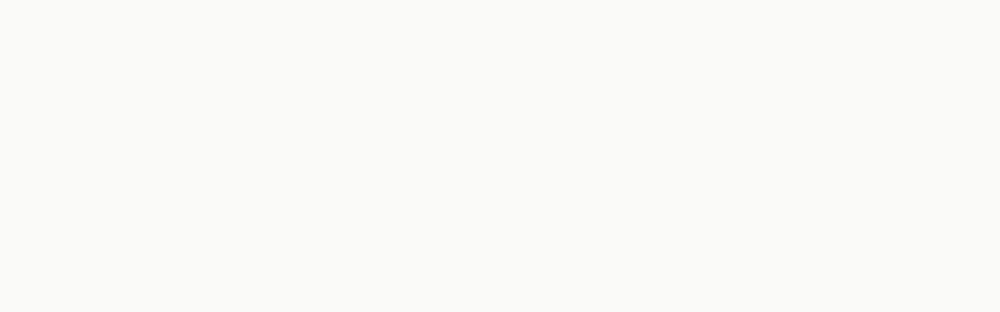
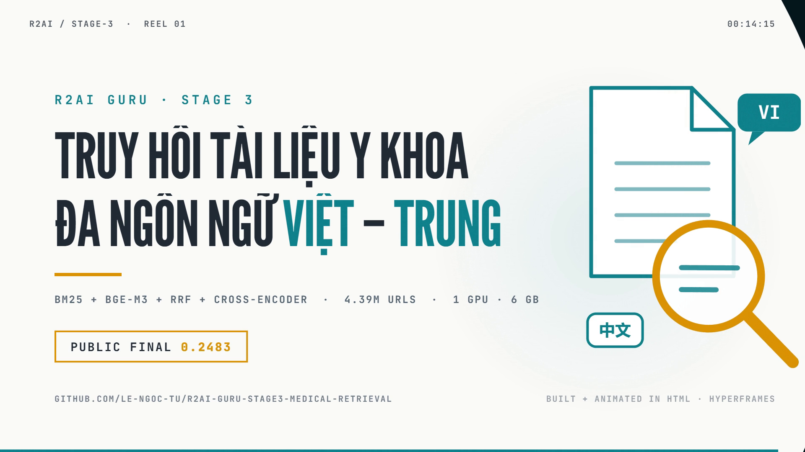
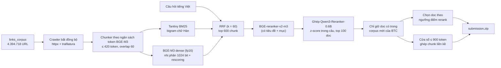
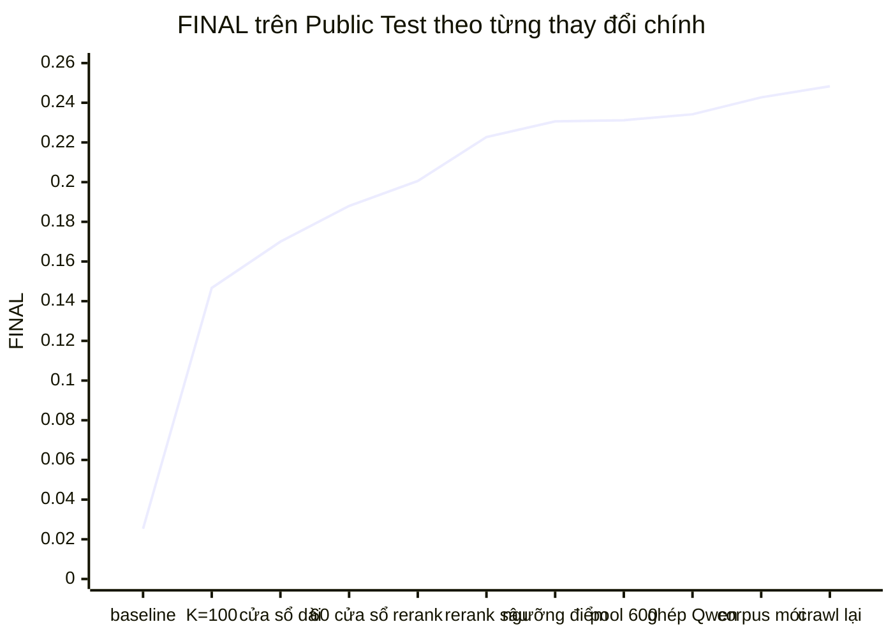

<p align="center">
  
</p>

<p align="center">
  
  
  
  
  
</p>

# R2AI GURU Stage 3 — Truy hồi tài liệu y khoa đa ngôn ngữ

Hệ thống truy hồi cho bài toán **R2AI GURU Stage 3 (Nhiệm vụ chung R2AI2026)**: với một câu hỏi y khoa tiếng Việt,
trả về **các tài liệu** (`relevant_docs`) và **các đoạn văn** (`relevant_chunks`) liên quan trong một kho 4,39 triệu URL
tiếng Việt và tiếng Trung. Toàn bộ pipeline (crawl, chunk, lập chỉ mục, truy hồi, rerank) chạy trên **một máy cá nhân**:
RTX 3050 6 GB, RAM 16 GB, ổ HDD, không dùng cloud GPU và không dùng API đóng.

> **English summary.** A hybrid retrieval system for multilingual (Vietnamese + Chinese) medical document retrieval over
> 4,394,718 URLs, built and run entirely on a single consumer machine (RTX 3050 6 GB, 16 GB RAM). Pipeline: async crawler
> → token-budget chunker → BM25 (Tantivy) + BGE-M3 dense retrieval (1024-bit binary quantization with fp16 rescoring) → RRF →
> BGE-reranker-v2-m3 cross-encoder blended with Qwen3-Reranker-0.6B (per-query z-score) → restriction to the organisers' updated corpus (with part of the previously unreachable Vietnamese pages re-crawled) → document selection by reranker-score threshold → long (≤900-token) merged-chunk windows.
> Best Public Test score: **FINAL 0.2483** (mean of Docs F2 0.2906 and Chunks F2 0.2060). The most useful finding: every query has ≈ 71 gold documents, not the "few documents" assumed at the start.
> All numbers below were measured; anything not measured is labelled as such.

---

## Mục lục

1. [Kết quả](#1-kết-quả)
   - [Showreel 15 giây](#showreel-15-giây)
   - [Slide trình bày](#slide-trình-bày)
2. [Bài toán và cách chấm điểm](#2-bài-toán-và-cách-chấm-điểm)
3. [Kiến trúc](#3-kiến-trúc)
4. [Dữ liệu: dùng bao nhiêu, bỏ bao nhiêu](#4-dữ-liệu-dùng-bao-nhiêu-bỏ-bao-nhiêu)
5. [Những phát hiện quan trọng](#5-những-phát-hiện-quan-trọng)
6. [Hành trình điểm trên leaderboard](#6-hành-trình-điểm-trên-leaderboard)
7. [Hướng đã thử và bị bác bỏ](#7-hướng-đã-thử-và-bị-bác-bỏ)
8. [Tái lập kết quả](#8-tái-lập-kết-quả)
9. [Cấu trúc repo](#9-cấu-trúc-repo)
10. [Hạn chế và điều chưa đo](#10-hạn-chế-và-điều-chưa-đo)
11. [Giấy phép, dữ liệu, mô hình](#11-giấy-phép-dữ-liệu-mô-hình)

---

## 1. Kết quả

Bài nộp Public Test tốt nhất (bài 6106 trên Codabench, 600 câu hỏi được chấm):

| Chỉ số | Giá trị |
| :--- | :---: |
| **FINAL** = trung bình (Docs F2, Chunks F2) | **0,2483** |
| Docs F2 (Precision / Recall) | 0,2906 (0,1791 / 0,4016) |
| Chunks F2 (Precision / Recall) | 0,2060 (0,2028 / 0,2384) |
| Số doc trung bình mỗi câu | 166,1 |
| Số chunk (cửa sổ ≤ 900 token) mỗi câu | ≈ 92 |
| Kích thước `submission.zip` | 99,7 MB (trần cuộc thi 100 MB) |
| Độ trễ truy hồi nóng (BM25 + dense + RRF, chưa tính rerank) | trung vị 256 ms/câu |

Điểm tăng từ **0,0253** (bài nộp đầu tiên) lên **0,2483**; mỗi bước tăng đều có nguyên nhân đo được, xem
[mục 6](#6-hành-trình-điểm-trên-leaderboard). Điểm Public chỉ phản ánh 600 câu; điểm Private (bộ câu khác) mới là
phép đo cuối cùng.

### Showreel 15 giây

<p align="center">
  <a href="assets/showreel.mp4"></a>
  <br /><sub>Bấm vào ảnh để xem video (15 giây, 1080p, không âm thanh).</sub>
</p>

Video và banner ở đầu trang đều được viết hoàn toàn bằng HTML và GSAP, dựng bằng [HyperFrames](https://hyperframes.heygen.com) (mã nguồn trong [`promo/`](promo/)). Mọi con số trên màn hình là số đo thật của dự án.
Kết xuất lại: `cd promo/showreel && npx hyperframes render` (hoặc `cd promo/banner && npx hyperframes render --format gif --gif-loop 0 --fps 15`).

### Slide trình bày

15 slide cho Demo Day (mỗi slide có ghi chú người nói) (bài toán, phần cứng, dữ liệu, kiến trúc, các phát hiện, hành trình điểm, kết quả âm, hạn chế): [`slides/r2ai-stage3-slides.html`](slides/r2ai-stage3-slides.html) (mở bằng trình duyệt; phím ← → để chuyển, `N` bật ghi chú diễn giả, `P` mở cửa sổ người nói riêng, `F` toàn màn hình) và bản PDF [`slides/r2ai-stage3-slides.pdf`](slides/r2ai-stage3-slides.pdf).

---

## 2. Bài toán và cách chấm điểm

- **Kho tri thức:** `links_corpus.parquet` của Ban Tổ chức, 4.394.718 URL (97 domain y tế, tiếng Việt và tiếng Trung).
  Đội thi tự crawl, làm sạch, chia chunk và lập chỉ mục.
- **Câu hỏi:** 1.200 câu y khoa tiếng Việt (`query.parquet`); Public Test chấm 600 câu.
- **Bài nộp:** một file `submission.json` trong `submission.zip` (≤ 100 MB). Mỗi câu gồm `relevant_docs` (danh sách `id` nguyên)
  và `relevant_chunks` (danh sách `{"doc_id", "chunk_text"}` với văn bản thật của đoạn, ≤ 1.024 token).
- **Điểm:** hai phép F2 độc lập (Recall quan trọng gấp 4 lần Precision), `FINAL = (Docs F2 + Chunks F2) / 2`.
  Một chunk nộp được tính đúng khi thuộc đúng tài liệu và **LCS token ≥ 0,40** so với một chunk tham chiếu
  (sau chuẩn hóa NFKC, HTML entity, chữ thường). `src/stage3/eval_f2.py` cài đặt đúng luật này.

Chi tiết thể lệ và công thức: [`docs/phan-tich/01-THONG-TIN-CUOC-THI.md`](docs/phan-tich/01-THONG-TIN-CUOC-THI.md),
[`docs/phan-tich/02-DANH-GIA-VA-CONG-THUC-F2.md`](docs/phan-tich/02-DANH-GIA-VA-CONG-THUC-F2.md).

---

## 3. Kiến trúc



| Tầng | Thành phần | Ghi chú |
| :--- | :--- | :--- |
| Crawl | `url_crawler.py` | asyncio, circuit breaker theo domain, checkpoint SQLite (dừng/chạy lại an toàn) |
| Chunk | `medical_chunker.py`, `chunk_corpus.py` | ≤ 420 token BGE-M3, overlap 60; `text` là chuỗi con nguyên văn của thân bài; Contextual Retrieval tĩnh (tiêu đề + mục ghép vào văn bản embed) |
| Sparse | `tantivy_indexer.py` | BM25 trên đĩa; chữ Hán tách bigram chồng lấp, còn lại tách theo ký tự chữ-số |
| Dense | `embed_corpus.py`, `dense_index.py` | BGE-M3 fp16; FAISS `IndexBinaryFlat` 1024 bit (≈ 1 GB) rồi rescoring top-200 bằng vector fp16 gốc (mmap) |
| Hợp nhất | `hybrid_search.py` | Reciprocal Rank Fusion, k = 60 |
| Rerank | `rerank_deep.py` | BGE-reranker-v2-m3 (fp16), có guard RAM / nhiệt độ GPU / VRAM để máy vẫn dùng làm việc được |
| Rerank bổ sung | `rerank_qwen.py` | Qwen3-Reranker-0.6B chấm chunk điểm cao nhất của 100 doc đầu mỗi câu; ghép z-score với điểm BGE (trọng số 0,5) trong `make_submission.py --qwen` |
| Chọn bài nộp | `make_submission.py` | doc theo ngưỡng điểm rerank; chunk là cửa sổ ghép chunk liền kề; mỗi câu luôn có ≥ 10 doc và ≥ 5 cửa sổ |
| Kiểm tra | `validate_submission.py` | schema, ≤ 1.024 token (đếm bằng tokenizer BGE-M3), chunk thuộc doc đã liệt kê, ≤ 100 MB |

Ngân sách phần cứng: chỉ mục BM25 2,7 GB, chỉ mục nhị phân 1,0 GB, vector fp16 15 GB (đọc mmap trên đĩa);
RAM tiến trình truy hồi ≈ 4 GB; VRAM đỉnh của BGE-M3 ≈ 1,3 GB.

---

## 4. Dữ liệu: dùng bao nhiêu, bỏ bao nhiêu

Số liệu đo trực tiếp trên `crawl_cache.sqlite3` và các shard chunk (không phải ước lượng):

| Hạng mục | Số lượng | Tỷ lệ |
| :--- | ---: | ---: |
| URL trong `links_corpus.parquet` | 4.394.718 | 100% |
| Trang crawl thành công (`done`) | 3.487.922 | 79,37% |
| Trang được chunk (đã loại trang hỏng mã hóa) | 3.033.854 | 69,03% của corpus |
| **Chunk được lập chỉ mục (BM25 + dense)** | **7.607.882** | tiếng Trung 76,5%, tiếng Việt 23,5% |
| Loại: bị WAF chặn (`banned_cooldown`) | 875.487 | 19,92% |
| Loại: cần render JavaScript (`needs_js_render`) | 28.710 | 0,65% |
| Loại: lỗi vĩnh viễn (`failed`) | 2.599 | 0,06% |
| Loại: lỗi giải mã ký tự (trang `cnkang.com`, `U+FFFD`) | 454.068 | 10,33% |
| **Tổng phần corpus chưa vào chỉ mục** | **1.360.864** | **30,97%** |

Bổ sung sau ngày 18/10 (corpus mới của Ban Tổ chức): crawl lại 117.353 trang tiếng Việt (`done` 3.487.922 → 3.605.275; 330.955 chunk thêm vào chỉ mục, tổng 7.938.837 chunk tiếng Việt và Trung; bỏ 31.258 trang lỗi mã hóa hoặc rỗng, chủ yếu `cnkang.com`) và thử 239.699/240.000 bản ghi PubMed (314.284 chunk tiếng Anh, không dùng trong bài chốt vì làm giảm điểm).

Tỷ lệ doc tham chiếu nằm trong phần chưa vào chỉ mục **chưa đo được** (không có nhãn đầy đủ), nên đây là một chặn trên
chưa lượng hóa của recall. Chi tiết nguyên nhân từng domain: [`docs/NHAT-KY-DU-AN.md`](docs/NHAT-KY-DU-AN.md) (mục 3),
báo cáo EDA: [`docs/phan-tich/14-BAO-CAO-EDA-GIAI-DOAN-2.md`](docs/phan-tich/14-BAO-CAO-EDA-GIAI-DOAN-2.md).

---

## 5. Những phát hiện quan trọng

1. **Mỗi câu hỏi có trung bình 71,0 doc tham chiếu** (trung vị 60, P10 = 12, P90 = 145, tối đa 190) và ≈ 74,7 chunk tham chiếu
   (≈ 1,05 chunk mỗi doc). Giả định ban đầu kế thừa từ Stage 2 ("trả vài doc, ít mà đúng") sai hoàn toàn và cho điểm 0,025.
   Lời giải là trả **hàng trăm** doc và cắt theo chất lượng, không theo một con số K nhỏ cố định.
2. **Bộ dev tự dựng đánh lừa.** Một bộ dev 743 cặp dựng từ ViHealthQA (mỗi câu ≈ 1,4 doc nhãn) cho kết luận ngược với
   leaderboard thật (ví dụ: reranker "kém RRF" trên dev nhưng tăng rõ trên leaderboard). Bài học: với nhãn thưa và lệch,
   leaderboard là phép đo duy nhất không thiên lệch; không chọn K hay reranker bằng dev tự dựng.
3. **Chunk dài thắng chunk ngắn.** Nộp cửa sổ ≤ 900 token (ghép chunk liền kề cùng tài liệu) thay vì chunk ≈ 350 token
   tăng Chunks Precision 3,3 lần (0,064 → 0,208) ở cùng cách xếp hạng, vì độ trùng LCS chia cho độ dài chunk **tham chiếu**.
4. **Dense giúp, không gây hại.** BM25 thuần ở cùng K chỉ đạt khoảng 54% điểm của RRF.
5. **Reranker có ích khi có tiêu đề.** Ghép `doc_title` và `section` vào văn bản chấm cho điểm cao hơn rõ rệt; rerank sâu hơn
   (pool 150 → 300 chunk) làm Docs F2 tăng +0,025 ở K = 150.
6. **Điểm rerank dự báo độ đúng mạnh hơn thứ hạng.** Tỷ lệ cửa sổ trúng theo điểm: dưới −4: 1,3%; [−2, 0): 9,8%; [0, 2): 19,4%;
   từ 4 trở lên: 37,1%. Vì vậy chọn doc bằng **ngưỡng điểm** tốt hơn K cố định (Docs F2 0,2513 → 0,2698).
7. **Nhãn nằm chủ yếu ở tài liệu tiếng Việt.** Trong 57.000 cửa sổ của một bài nộp, tài liệu thuộc các domain tiếng Trung
   (14 domain đã định danh) chiếm 13,1% bài nộp nhưng chỉ 5,8% số cửa sổ trúng (tỷ lệ trúng 7,2% so với 17,6% ở domain tiếng Việt),
   dù 76,5% chunk của kho là tiếng Trung. Đây là phân loại ngôn ngữ theo domain, không phải đo trực tiếp.
8. **Corpus thay đổi giữa cuộc thi (18/10).** Ban Tổ chức phát hành `links_corpus_vi_en_zh.parquet` (1.220.598 URL: 740.598 tiếng Việt, 240.000 tiếng Trung, 240.000 PubMed tiếng Anh), trong đó 980.598 URL trùng đúng `id` và URL với corpus cũ. Mọi cửa sổ trúng của các bài đã chấm (9.894 trên 9.894) đều thuộc corpus mới, trong khi ≈ 6,3% cửa sổ nộp nằm ngoài và không cái nào trúng. Chỉ cần bỏ các doc ngoài corpus mới đã nâng FINAL từ 0,2342 lên **0,2427**. Chỉ mục của chúng tôi ban đầu chỉ phủ **53,6%** corpus mới (tính cả 240.000 PubMed trong mẫu số). Sau khi crawl lại 117.353 trang tiếng Việt từng bị coi là bị chặn (User-Agent trình duyệt, 4 request đồng thời mỗi domain, tuân thủ `robots.txt`), FINAL tăng thêm **+0,0056** (0,2427 → **0,2483**), chủ yếu ở Recall tài liệu (+0,0195). Thử thêm 240.000 bản ghi PubMed (tiêu đề + tóm tắt qua NCBI efetch) làm FINAL **giảm** 0,0040: Recall tài liệu không đổi, Precision giảm, nên nhãn gần như không chứa PubMed (bằng chứng gián tiếp). Phần tiếng Việt còn thiếu ≈ 130.000 trang, trong đó `nhathuoclongchau.com.vn` (79.598 trang) chặn theo dấu vân TLS và chúng tôi không vượt cơ chế chặn này.

---

## 6. Hành trình điểm trên leaderboard



| Bước | FINAL | Docs F2 | Chunks F2 | Thay đổi và nguyên nhân |
| :--- | :---: | :---: | :---: | :--- |
| Baseline (3 doc, 5 chunk) | 0,0253 | 0,0354 | 0,0153 | giả định số lượng doc sai |
| RRF, 100 doc × 1 chunk | 0,1467 | 0,2133 | 0,0801 | trả nhiều doc |
| 150 doc, 30 cửa sổ ≤ 900 token | 0,1700 | 0,2241 | 0,1159 | chunk dài tăng precision 3,3 lần |
| ~230 doc, 60 cửa sổ | 0,1880 | 0,2265 | 0,1495 | thêm cửa sổ |
| Rerank (pool 150), ~217 doc, 60 cửa sổ | 0,2006 | 0,2265 | 0,1748 | rerank chọn đúng cửa sổ |
| Rerank sâu (pool 300), 150 doc, 90 cửa sổ | 0,2227 | 0,2491 | 0,1964 | rerank đổi được tập doc |
| Doc theo ngưỡng điểm ≥ −2,5 | 0,2306 | 0,2626 | 0,1987 | cắt theo điểm thay vì K |
| Pool 600, ngưỡng ≥ −1,5 | 0,2312 | 0,2698 | 0,1927 | thêm ứng viên cho rerank |
| + Ghép Qwen3-Reranker-0.6B | 0,2342 | 0,2735 | 0,1949 | thêm một bộ chấm độc lập; cả hai tầng cùng tăng |
| + Lọc theo corpus mới | 0,2427 | 0,2820 | 0,2033 | nhãn chỉ nằm trong corpus mới; bỏ doc ngoài đó |
| **+ 117.353 trang tiếng Việt crawl lại (bài chốt)** | **0,2483** | **0,2906** | **0,2060** | tăng độ phủ chỉ mục; Recall doc +0,0195 |
| (thử thêm 240.000 PubMed, không dùng) | 0,2443 | 0,2860 | 0,2026 | Recall doc không đổi, Precision giảm |

Toàn bộ 27 bài nộp đã chấm nằm ở [`results/leaderboard_history.csv`](results/leaderboard_history.csv). Từ bước "ngưỡng điểm"
trở đi, mọi tinh chỉnh (số doc, ngưỡng, cỡ cửa sổ, pool) và cả bước ghép Qwen (+0,003) chỉ còn đem lại vài phần nghìn FINAL, ngang mức nhiễu của 600 câu Public: hệ thống đã **phẳng**.

---

## 7. Hướng đã thử và bị bác bỏ

| Hướng | Kết quả đo | Kết luận |
| :--- | :--- | :--- |
| BM25 thuần thay RRF | 54% điểm của RRF ở K = 100 | dense cần thiết |
| Cửa sổ 980 token thay 900 | Chunks F2 0,1927 → 0,1897 | precision mỗi cửa sổ +5,4% nhưng số cửa sổ −8%: hòa |
| Phân bổ cửa sổ theo điểm toàn cục | Chunks F2 0,1987 → 0,1927 trên pool sâu | không tốt hơn cố định theo hạng |
| Gộp điểm cấp doc (tổng sigmoid, số chunk…) | AUC 0,652 → 0,663 (offline) | không đáng làm |
| Cắt số doc theo từng câu | oracle 3 mức +0,021 Docs F2, quy tắc thực tế (kiểm tra chéo 2 nửa) chỉ +0,006 | trong sai số |
| Tăng K lên ≈ 223 doc | Docs F2 0,2688 < 0,2698 (167 doc) | đỉnh ở ≈ 170 – 190 doc |

Phân tích offline dùng file chi tiết từng bài nộp mà bộ chấm trả về (chỉ để chọn cấu hình, không dùng để huấn luyện mô hình).

---

## 8. Tái lập kết quả

Yêu cầu: Python 3.11, NVIDIA GPU ≥ 6 GB VRAM, RAM 16 GB (nên trống ≥ 8 GB khi chạy các bước nặng), ≥ 60 GB đĩa trống,
dữ liệu của Ban Tổ chức đặt tại `data/ViBioMIR/` (`links_corpus.parquet`, `query.parquet`) và `data/ViBioMIR_new/` (`links_corpus_vi_en_zh.parquet`, bản corpus Ban Tổ chức cập nhật ngày 18/10/2026, commit `71be0e1` của `AIGuruTinix/ViBioMIR`); không có trong repo vì giấy phép CC BY-NC 4.0.

```bash
git clone https://github.com/Le-Ngoc-Tu/r2ai-guru-stage3-medical-retrieval.git
cd r2ai-guru-stage3-medical-retrieval
python -m venv .venv && source .venv/bin/activate        # Windows: .venv\Scripts\activate
pip install torch --index-url https://download.pytorch.org/whl/cu126
pip install -r requirements.txt

# Tải ba model về data/hf_cache (code tìm model theo đường dẫn snapshot trong thư mục này)
python -c "from huggingface_hub import snapshot_download as d; \
d('BAAI/bge-m3', revision='5617a9f61b028005a4858fdac845db406aefb181', cache_dir='data/hf_cache'); \
d('BAAI/bge-reranker-v2-m3', revision='953dc6f6f85a1b2dbfca4c34a2796e7dde08d41e', cache_dir='data/hf_cache'); \
d('Qwen/Qwen3-Reranker-0.6B', revision='e61197ed45024b0ed8a2d74b80b4d909f1255473', cache_dir='data/hf_cache')"
```

Bài chốt (bài 6106) được tạo qua hai giai đoạn, theo đúng thứ tự dưới đây; các bước chạy trong `src/stage3/` và đều chạy lại an toàn (phần đã xong được bỏ qua):

```bash
cd src/stage3

# --- Giai đoạn A: corpus ban đầu (4.394.718 URL) ---
python url_crawler.py                                    # 1. crawl (nhiều ngày; checkpoint SQLite)
python chunk_corpus.py                                   # 2. chunk -> data/chunks (≈ 7,1 giờ)
python tantivy_indexer.py --index-dir ../../data/tantivy_index   # 3. BM25 (≈ 16 phút)
python embed_corpus.py                                   # 4. BGE-M3 dense (nhiều ngày GPU; có guard nhiệt độ/RAM)
python dense_index.py build                              # 5. chỉ mục nhị phân (≈ 2,6 phút)

python make_submission.py --source rrf                   # 6. truy hồi RRF độ sâu 300
python make_submission.py --source rrf600                #    và độ sâu 600
python rerank_deep.py 0 150                              # 7. rerank sâu (≈ 7,3 giờ GPU tổng cộng)
python rerank_deep.py 150 300
python rerank_deep.py 0 600 --candidates candidates_rrf600_d600.jsonl
python rerank_qwen.py qwen_top100.jsonl --docs 100      # 8. Qwen3-Reranker-0.6B cho 100 doc đầu (≈ 3,7 giờ GPU)

# --- Giai đoạn B: mở rộng độ phủ theo corpus mới (18-19/10/2026) ---
python recrawl_vi.py --per-domain 4 --domains suckhoecongdongonline.vn baohaiphong.vn baonghean.vn \
  baodanang.vn youmed.vn baocantho.com.vn dantri.com.vn thaythuocvietnam.vn hanoimoi.vn      # 9. crawl lại 117.353 trang tiếng Việt
python chunk_extra.py vi                                 # 10. chunk phần crawl lại -> data/chunks/shard_90000000
python fetch_pubmed.py && python chunk_extra.py pubmed   #     PubMed (đã chạy trong bài chốt; bị lọc bỏ ở bước 15 bằng --no-pubmed)
python tantivy_indexer.py --index-dir ../../data/tantivy_index   # 11. lập chỉ mục phần mới
R2AI_MIN_FREE_GB=1.5 python embed_corpus.py              # 12. embed phần mới (đặt ngưỡng RAM thấp hơn nếu máy hẹp RAM)
python dense_index.py build                              # 13. dựng lại chỉ mục nhị phân
python make_submission.py --source rrf600v2              # 14. truy hồi lại trên chỉ mục mở rộng
python rerank_deep.py 0 601 --candidates candidates_rrf600v2_d600.jsonl --new-corpus    #     chỉ chấm cặp chưa có điểm
python rerank_qwen.py qwen_top100_v2.jsonl --docs 100 --reuse qwen_top100.jsonl --new-corpus

python make_submission.py --source rerank --qwen qwen_top100_v2.jsonl 0.5 --new-corpus --no-pubmed --dynamic -1.5 400 110000 200   # 15. bài chốt
python validate_submission.py ../../data/submission/submission_rerank_dyn-1.5_400_110000_qwen0.5_newcorpus_nopubmed.zip
```

Bản đã nộp: file `.zip` 99.713.430 byte, SHA256 `8b8a54d12fec232ee7ec3eac12f1ae12086f16c4a784e0def75529eb71cd18ef` (tạo lại có thể cho hash khác vì dấu thời gian trong zip; nội dung `submission.json` là thứ cần so). Các tệp trung gian (ứng viên truy hồi, điểm rerank, điểm Qwen) đủ để chạy riêng bước 15 mà không cần GPU.

Tham số `--dynamic DOC_MIN DOC_CAP WINDOW_BUDGET WINDOW_CAP`: lấy doc có điểm rerank ≥ `DOC_MIN` (tối đa `DOC_CAP` doc);
chọn `WINDOW_BUDGET` cửa sổ có điểm cao nhất trên toàn bộ các câu (mỗi câu tối đa `WINDOW_CAP`). Guard của bước rerank:
tạm dừng khi RAM trống < 3,5 GB, GPU ≥ 80°C hoặc VRAM trống < 1,5 GB; tạo file `data/submission/STOP_RERANK` để dừng êm.
Các bước 4 và 7 cần chạy lâu; thời gian cụ thể đo được nằm trong [`docs/NHAT-KY-DU-AN.md`](docs/NHAT-KY-DU-AN.md).

Đo điểm cục bộ theo luật chính thức: `python eval_f2.py` (tự kiểm tra công thức).

---

## 9. Cấu trúc repo

```
.
├── README.md
├── LICENSE                      # MIT cho mã nguồn tự viết
├── THIRD-PARTY-NOTICES.md       # giấy phép thư viện / model / dataset đã xác minh
├── requirements.txt
├── assets/                      # banner.gif (động), banner.svg (tĩnh), showreel.mp4 + ảnh poster
├── slides/                      # slide trình bày: HTML (có ghi chú diễn giả) + PDF
├── promo/                       # mã nguồn HTML/GSAP của banner và showreel (HyperFrames)
├── results/leaderboard_history.csv   # 27 bài nộp đã chấm: cấu hình và điểm
├── src/stage3/                  # toàn bộ mã nguồn pipeline
│   ├── url_crawler.py           #   crawl bất đồng bộ + circuit breaker
│   ├── medical_chunker.py       #   chunk theo ngân sách token
│   ├── chunk_corpus.py          #   chunk toàn corpus theo shard
│   ├── tantivy_indexer.py       #   chỉ mục BM25
│   ├── embed_corpus.py          #   embed BGE-M3 (guard RAM/nhiệt độ)
│   ├── dense_index.py           #   chỉ mục nhị phân FAISS + rescoring
│   ├── hybrid_search.py         #   BM25 + dense + RRF
│   ├── rerank_deep.py           #   rerank sâu BGE-reranker-v2-m3
│   ├── rerank_qwen.py           #   chấm bổ sung Qwen3-Reranker-0.6B cho top 100 doc
│   ├── recrawl_vi.py            #   crawl lại các domain tiếng Việt từng bị chặn (User-Agent trình duyệt, tốc độ thấp)
│   ├── fetch_pubmed.py, chunk_extra.py   #   lấy tóm tắt PubMed (efetch) và chunk phần bổ sung
│   ├── make_submission.py       #   chọn doc / cửa sổ và đóng gói bài nộp
│   ├── validate_submission.py   #   kiểm tra bài nộp trước khi nộp
│   ├── eval_f2.py               #   F2 theo luật LCS ≥ 0,40
│   ├── build_mock_dev.py, eval_retrieval.py, rerank_dev.py, tune_threshold.py   # bộ dev tự dựng (xem mục 5.2)
└── docs/
    ├── NHAT-KY-DU-AN.md         # nhật ký thực nghiệm đầy đủ, có ngày và số đo
    └── phan-tich/               # 14 tài liệu phân tích thể lệ, kiến trúc, dữ liệu, EDA
```

---

## 10. Hạn chế và điều chưa đo

- **Luật chấm chunk đổi ngày 23/10/2026** (chunk dự đoán phải đạt LCS ≥ 40% cả so với chunk đáp án lẫn so với chính nó). Nộp lại đúng file bài chốt cho
  FINAL 0,2384 (Docs F2 0,2906 không đổi; Chunks F2 0,2060 → 0,1862). Cửa sổ 900 token được chọn cho luật cũ; cửa sổ ngắn hơn có thể tốt hơn
  nhưng **chưa được thử**. Các số 0,2483 ở trên là điểm theo luật cũ.
- **Điểm Public chỉ từ 600 câu**, và các ngưỡng (K, điểm rerank) được chọn trên chính những câu này; sai số giữa các bài sát nhau
  (±0,003) nằm trong nhiễu. Chưa biết điểm Private.
- **Độ phủ corpus mới: 772.164 / 980.598 = 78,7%** tài liệu không phải PubMed đã vào chỉ mục (đo bằng đối chiếu `doc_id` của mọi shard chunk với `links_corpus_vi_en_zh.parquet`; trước khi crawl lại là 654.811, tức 66,8%). Còn thiếu ≈ 130.000 trang tiếng Việt (chặn WAF, cần render JavaScript hoặc 403) và ≈ 76.500 trang tiếng Trung; PubMed đã thử và không giúp.
- **Chưa thử truy vấn bằng tiếng Trung** (dịch truy vấn sang tiếng Trung hoặc mở rộng đa ngôn ngữ) và không có nhãn tiếng Trung
  để đo riêng. Truy vấn tiếng Việt vẫn lấy được tài liệu tiếng Trung nhờ dense BGE-M3 đa ngôn ngữ; số liệu ở mục 5 chỉ là bằng chứng
  gián tiếp (phân loại ngôn ngữ theo domain).
- **30,97% corpus chưa vào chỉ mục** (xem [mục 4](#4-dữ-liệu-dùng-bao-nhiêu-bỏ-bao-nhiêu)); tỷ lệ doc tham chiếu rơi vào phần đó chưa đo.
- **Đếm token của bộ chấm lệch ± ~30 token** so với tokenizer BGE-M3, nên cửa sổ được chừa biên dưới 1.024 token.
- **Chưa kiểm chứng ngoài máy gốc:** pipeline chạy trên Windows 11 với PyTorch 2.14.1 + CUDA 12.6; các đường dẫn Linux và hiệu năng trên GPU khác chưa thử.
- Mã nguồn có comment và nhật ký bằng tiếng Việt vì đây là bài dự thi tiếng Việt.

---

## 11. Giấy phép, dữ liệu, mô hình

- **Mã nguồn tự viết:** [MIT](LICENSE) © 2026 Lê Ngọc Tú.
- **Dữ liệu:** dataset `ViBioMIR` (MedKB — AI Guru / TiniX) giữ nguyên giấy phép **CC BY-NC 4.0**, không nằm trong repo.
  Nội dung crawl thuộc bản quyền của các trang nguồn, không phân phối lại.
- **Mô hình dùng trong bài nộp cuối:** [BAAI/bge-m3](https://huggingface.co/BAAI/bge-m3) và
  [BAAI/bge-reranker-v2-m3](https://huggingface.co/BAAI/bge-reranker-v2-m3) (MIT; open-weight, < 15B tham số, công bố trước 01/08/2026).
  [Qwen3-Reranker-0.6B](https://huggingface.co/Qwen/Qwen3-Reranker-0.6B) (Apache-2.0) được ghép với BGE-reranker-v2-m3 trong bài nộp cuối.
- Danh sách đầy đủ kèm giấy phép đã xác minh: [`THIRD-PARTY-NOTICES.md`](THIRD-PARTY-NOTICES.md).

```bibtex
@online{medkb,
  title   = {MedKB -- Medical Knowledge Base},
  url     = {https://medkb.tinix.ai/},
  urldate = {2026-09-29}
}
```

**Tác giả:** Lê Ngọc Tú — bài dự thi *Road to AI (R2AI) GURU, Stage 3*.
